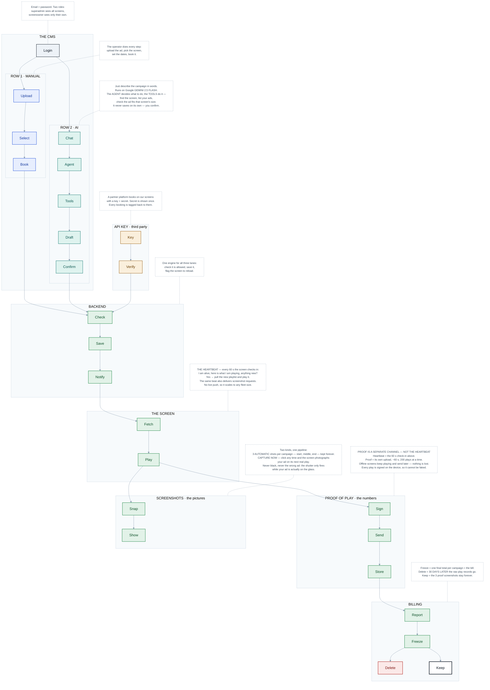

# Mark AI CMS — Backend Flow

**Scope: backend only.** The advertiser-facing frontend flow is documented separately.

Every block is **one word**. Explanations live in the dashed **note boxes beside each container**,
with full detail in the ledger below.

---

## The flowchart

**Legend**

| Colour | Meaning |
|---|---|
| Grey | Shared entry — authentication and scoping |
| Blue | Row 1 — manual lane |
| Teal | Row 2 — AI lane |
| Amber | Third-party lane — API key |
| Green | Backend trunk — the shared engine, one code path |
| Dashed grey | Edge / on-screen player (not backend, shown for continuity) |
| Red | Deletion — the only place data is destroyed |
| Bold black | Kept permanently |

---

## Appendix — full technical detail (not part of the chart)

| # | Block | What actually happens |
|---|-------|----------------------|
| 1 | **Login** | `POST /api/cms/auth/login {email, password}`. Operators are identified by **email**, stored lowercased. Password checked against a stdlib **pbkdf2_sha256** hash — no native crypto dependency. |
| 2 | **Token** | **CMS JWT**, HS256, `type="cms"`, role in the claim. A different token family from the long-lived screen JWT the player holds; the two are never interchangeable. |
| 3 | **Role** | Exactly two. **superadmin** — mints users and API keys, books campaigns, all screens. **screenowner** — only the screens a superadmin assigned to them. |
| 4 | **Scope** | Every screen / loop / booking route re-checks the assignment server-side. Scoping is enforced **in SQL** on list endpoints, never filtered in the client — one owner cannot see another owner's screens, bookings or reports at all. |
| 5 | **Upload** | `POST /cms/content/upload-session` mints a **GCS resumable session** bound to the declared file size, so the bucket enforces the limit itself. Cloud Run hard-caps HTTP/1 bodies at 32 MiB and returns a 413 before the app runs — so creative bytes never transit the API. |
| 6 | **Commit** | `POST /cms/content/commit` trusts only the **signed upload token** (blob path, size, type, user), never a client-supplied blob name, and re-verifies the object in the bucket before writing the media record. |
| 7 | **Screen** | Screens are **not created here** — they self-register from the device. The CMS edits name, location, operating hours, and the two owner-fixed loop timings: how long every ad plays, and when the loop restarts. Slots = loop ÷ slot. A client can never set play duration. |
| 8 | **Compose** | Screen + creative + recurrence rule: start, end, days-of-week, daily windows, schedule type (`continuous`, `specific_time`, `times_per_day`, `custom`). |
| 9 | **Submit** | `POST /cms/bookings` — the single write that enters the shared engine. |
| 10 | **Prompt** | `POST /cms/ai/sessions/{id}/message`. Same JWT, same role, same scope as Row 1. |
| 11 | **Guard** | A scope classifier runs **before** the agent. Off-topic messages get a fixed refusal and never reach the model — no tokens, no tools, no state change. Skipped when the user is obviously on task, and **fails open**, because a hardened system-prompt rule is the backstop. |
| 12 | **Memory** | Last 20 turns replay verbatim; older turns fold into a rolling summary. Two turns on one session are serialised by a distributed lock so they cannot clobber each other's draft. |
| 13 | **Agent** | Tool-calling agent over `gemini-2.5-flash`, pinned in one config line. |
| 14 | **Tools** | Read tools — find screens by place or name, list creatives, check a creative fits a screen's resolution and orientation, fleet stats, proof-of-play. Every tool inherits the caller's scope. |
| 15 | **Draft** | An **order-free notepad**: the operator can give facts in any order, the agent fills slots as they resolve and reports only what is still missing. A draft is set aside, never deleted, and can be recalled. |
| 16 | **Propose** | **The AI never writes.** Its write tools return proposals, not database changes. |
| 17 | **Card** | Every proposal in a turn rides **one** action card, so "book this on two cafés" is two proposals on one card. Streamed over SSE that replays from Postgres, so a reconnect never loses the answer. |
| 18 | **Confirm** | A human click. Each action is marked executed the moment it succeeds, so a mid-batch failure cannot double-run on retry. The executors call the same service functions the manual form does. |
| 19 | **Key / Secret** | A superadmin mints a key id plus a 32-byte secret. The secret is returned **exactly once** and stored only as a pbkdf2_sha256 hash — it cannot be recovered, only revoked and re-minted. |
| 20 | **Verify** | Headers `X-Api-Key-Id` + `X-Api-Secret` on every `/api/ext/*` call. Last-used is stamped on each verified call; revocation takes effect immediately. |
| 21 | **Push** | Partners get the same primitives, not a lesser API: list screens and detail, the same two-phase creative upload, create / list / cancel bookings, per-booking reports, per-play records. |
| 22 | **Attribute** | Every partner booking records the **key that created it** plus an optional external reference — their user id, name and order id. A play therefore traces back to the partner, their end customer and their order. |
| 23 | **Validate** | Screen and creative resolved or 404; the caller's permission on that screen re-checked server-side. |
| 24 | **Clamp** | The campaign is forced inside the screen's declared operating window. Out-of-hours is rejected **422**; a booking that supplies no window inherits the screen's. |
| 25 | **Persist** | The booking row is written. |
| 26 | **Bump** | The screen's schedule timestamp is bumped **in the same transaction** as the data change. Required for correctness: a screen that saw a newer timestamp while still reading old data would mark itself current with a stale schedule. Server time vs server time — the screen only echoes a value we generated — so device clock skew is irrelevant. |
| 27 | **Arm** | Three screenshot jobs (start / mid / end) armed at points on the campaign's **playable** timeline — the union of its real play intervals in IST — not the raw calendar span. A shot therefore always lands on a genuine play of that exact creative on a lit panel. |
| 28 | **Beat** | `POST /api/playback/heartbeat`, every **60 s**. Carries what is playing now and the schedule timestamp the screen last saw. |
| 29 | **Flag** | The server answers `reload_needed` when the screen is behind. **No WebSocket** — this is the single live channel, which is precisely what makes the API stateless and horizontally scalable. |
| 30 | **Fetch** | `GET /api/screens/me/schedule` — a full re-fetch, only when flagged. |
| 31 | **Resolve** | Three sources — campaign bookings, the screen owner's own loop, and legacy schedules — merge into **one flat playlist**, every slot pinned to the screen's fixed slot duration. Mode resolution stays in the backend. |
| 32 | **Gate** | Outside the screen's operating window the playlist is empty and the panel is black. The heartbeat drops to a slow keep-alive rather than going silent, so an hours change still reaches a closed screen. A quiet screen outside hours reports `off_hours`, not `offline`. |
| 33 | **Sign** | **ECDSA P-256 / SHA-256** over a canonical record of the play, private key sealed in the Android Keystore — it never leaves the device. |
| 34 | **Chain** | Each record names the previous record's hash plus a monotonic per-screen sequence number, so deletion or reordering breaks continuity and is detected. |
| 35 | **Batch** | Up to **200 records** per request, drained from an append-only on-disk log cleared only after the server accepts the batch. |
| 36 | **Post** | `POST /api/playback/proof` — **a separate endpoint on its own schedule. It is not carried on the heartbeat.** |
| 37 | **Verify** | The backend rebuilds the identical canonical bytes and verifies the signature against the screen's registered public key. The response reports **accepted** and **verified** separately. A valid signature with a chain gap is still stored and verified but logged, so one genuinely lost record cannot stall ingestion forever. |
| 38 | **Store** | One row per play. Records with a bad signature are stored **unverified** rather than discarded — evidence is never silently dropped. |
| 39 | **Report** | `GET /cms/reports/proof-of-play` — filtered by screen and date range, paginated, scoped to the caller's role. |
| 40 | **Complete** | A campaign is complete when it can **never play again**, not when its end date passes. A booking ending 23:59 whose only daily window is 14:12–15:00 completes at 15:00. `cancelled` and `completed` are terminal, and there is no hard delete anywhere in the CMS. |
| 41 | **Freeze** | One frozen summary row per campaign — the billing artefact. A late play arriving after the freeze tops the summary up on arrival; the summary is never recomputed, because that would move a number already invoiced. |
| 42 | **Latch** | The rollup marker is set with a conditional update, so exactly one server instance freezes the bill even though the sweep runs on every cold start. |
| 43 | **Prune** | **30 days after the freeze**, a daily job deletes the raw signed play records and the per-play screenshots. It refuses to touch any campaign whose summary was never frozen. |
| 44 | **Keep** | The **three milestone screenshots are never deleted**, by this job or anything else. Exactly one frame per milestone exists, forever, enforced by a database constraint. |

---

## Hard numbers

| Parameter | Value |
|---|---|
| Heartbeat interval | **60 s** (15 min keep-alive outside operating hours) |
| Proof-of-play upload | own worker · ~1 request / 60 s · ≤ 200 records per request |
| Schedule re-fetch fallback | 3 min |
| Local re-gate (no network) | 15 s |
| Worst-case edit → screen | 1 heartbeat |
| Play signature | ECDSA P-256 / SHA-256, DER, base64 |
| Tamper evidence | per-screen hash chain (prev-hash + sequence) |
| CMS auth | JWT HS256, `type="cms"`, role-scoped |
| Partner auth | `X-Api-Key-Id` + `X-Api-Secret` · secret hashed, shown once |
| Raw proof-of-play retention | **30 days after summary freeze** |
| Milestone screenshot retention | **permanent** |
| Live push | none — REST + heartbeat, stateless, horizontally scalable |
